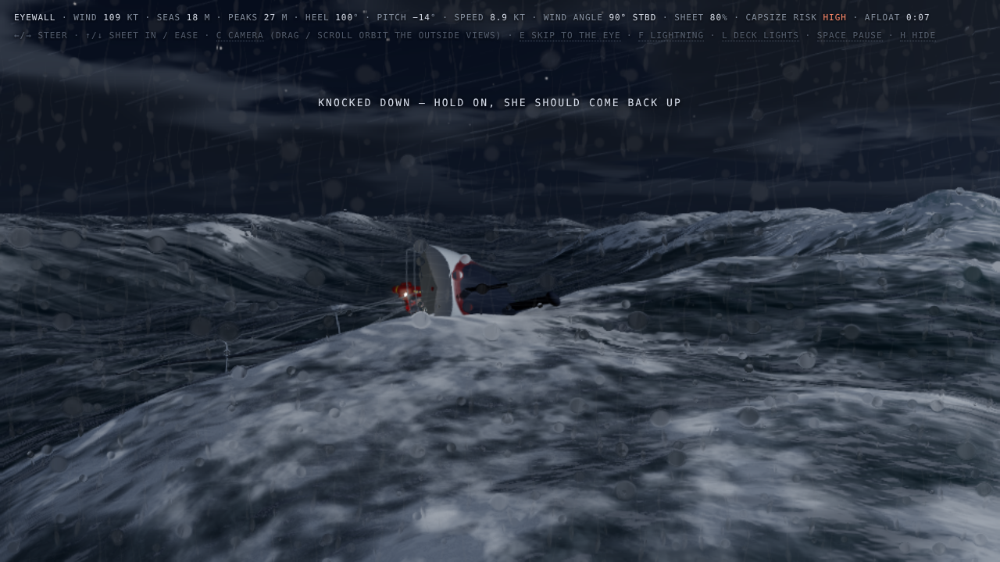

# stormy-sea-night

A single-file three.js scene: a 50 ft sloop under storm jib and deep-reefed main, working through seas and wind modelled on Hurricane Ivan (2004) under a full moon and fast-moving cloud. You steer it from the helm.

## Run

Live: https://jaredevans.github.io/stormy-sea-night/

Or open `index.html` locally in a current Chrome, Safari or Edge. It needs WebGL 2 and an internet connection, because three.js r170 loads from the jsDelivr CDN.

## Controls

- `←` / `→`: rudder. The sails set themselves to the new wind angle and swap sides when you tack or gybe.
- `↑` / `↓`: sheet in / ease. Sheeting in gives more drive and more heel; easing spills wind and stands the boat up.
- `C`: cycle cameras (captain's eyes, just astern, chase, aerial, bow-on)
- `E`: skip to the next change in the storm (into the eye, or out of it)
- `F`: toggle lightning
- Drag / scroll: orbit and zoom in the three outside views
- `L`: toggle deck lights
- `Space`: pause
- `H`: hide the readout

## Staying upright

Left alone, the boat holds its starting course close to the wind and sails on. Two things put it in danger:

- A breaking crest striking it across the beam (roughly 50–130° off the seas), worse with the sheets hard in.
- Running with the seas too fast: it surfs, broaches beam-on and is hit.

Past about 66° of roll the boat is knocked down: laid flat for a couple of seconds, then it rights itself slowly. It only rolls right over if it went down very fast or a second breaking sea catches it while it is down. Then the screen says why and how long you stayed afloat, and the run restarts after 5 seconds.

To stay up:

- Keep the bow or the stern to the seas. The seas keep their direction through the eye and the wind shift, so this is judged against the waves, not the wind.
- Ease the sheets before turning across the waves, and when running.
- Pointing closer than about 22° to the wind stalls the boat "in irons".

## The storm

- **Eyewall (150 s):** full wind, rain, spume racing over the surface, lightning, and visibility that closes in with each gust.
- **The eye (75 s):** the wind and rain die, the sky clears to moon and stars inside a ring of cloud, and the seas stay as they were. With no wind there is almost no steerage.
- **Far eyewall (150 s):** the wind returns from the opposite direction, against the old seas.

The storm then loops back through another eye, which a real one would not.

## On board

- Green water sweeps the deck when the bow buries; the cockpit fills and drains.
- Spray and rain bead and run on the lens, and the view jolts on slams and knockdowns.
- A red-lit binnacle at the wheel shows heading, wind angle, speed, heel and wind speed.
- The helmsman wears a lifejacket and harness tether; a strobe flashes on the water after a capsize.

If your system asks for reduced motion, camera shake and lightning start switched off.

## Conditions

The sea and wind follow what was measured when Hurricane Ivan crossed Naval Research Laboratory wave gauges in the Gulf of Mexico on 15 September 2004 (Wang et al., *Science*, 2005).

| | Ivan, measured | This scene |
|---|---|---|
| Significant wave height | 17.9 m | 17.9 m |
| Largest waves | 27.7 m | top 1% average about 27 m |
| Wind | about 200 km/h (108 kt) | 109 kt, gusting higher |

Deliberate departures: in the eyewall the full moon still breaks through the cloud, where a real eyewall sky would be solid overcast; the ring of cloud around the eye is lower beneath the moon so the moon stays in view; and the boat keeps its storm sails, which no sail would survive in that wind.

## How it works

- Sea: twelve Gerstner wave trains, including cross seas up to 60° off the wind, with normals and foam computed per pixel. Five trains of similar size near the dominant wavelength drift in and out of step, so the biggest waves arrive unpredictably.
- Breakers: breaking crests pitch forward, with whitewater running down the front face.
- Boat: heave, pitch and roll are driven by the same wave table the surface is drawn with.
- Sailing: speed follows a simple polar by true wind angle and sheet trim; knockdowns come from breaking crests on the beam.
- Sky: procedural moon, stars and cloud; moonlight dims as cloud crosses the moon.
- Rain, spray, spume, lightning, navigation and deck lights, bloom, and a screen-space water-on-lens pass.
