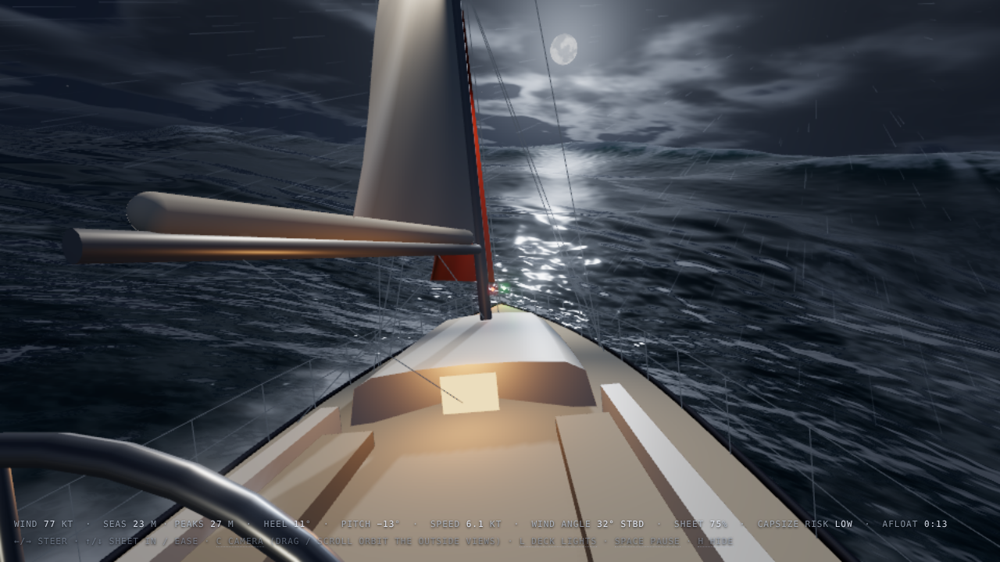
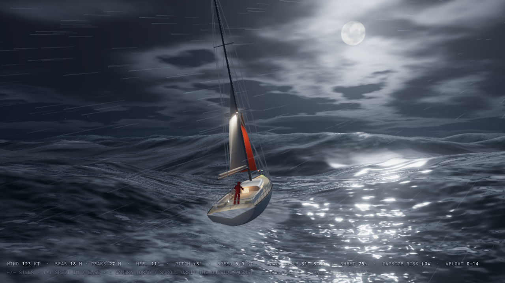

# stormy-sea-night

A single-file three.js scene: a 50 ft sloop under storm jib and deep-reefed main, working through hurricane seas running 22–25 m under a full moon and fast-moving cloud. You steer it from the helm.

## Run

Live: https://jaredevans.github.io/stormy-sea-night/

Or open `index.html` locally in a current Chrome, Safari or Edge. It needs WebGL 2 and an internet connection, because three.js r170 loads from the jsDelivr CDN.

## Controls

- `←` / `→`: rudder. The sails set themselves to the new wind angle and swap sides when you tack or gybe.
- `↑` / `↓`: sheet in / ease. Sheeting in gives more drive and more heel; easing spills wind and stands the boat up.
- `C`: cycle cameras (captain's eyes, just astern, chase, aerial, bow-on)
- Drag / scroll: orbit and zoom in the three outside views
- `L`: toggle deck lights
- `Space`: pause
- `H`: hide the readout

## Staying upright

Left alone, the boat holds its starting course close to the wind and sails on. Past about 69° of roll it capsizes: the screen says why and how long you stayed afloat, and the run restarts after 5 seconds. Two things put it over:

- A breaking crest striking it across the beam (roughly 50–130° off the wind), worse with the sheets hard in.
- Running downwind too fast: it surfs, broaches beam-on and is rolled.

To stay up:

- Keep the bow or the stern to the seas.
- Ease the sheets before turning across the waves, and when running downwind.
- Pointing closer than about 22° to the wind stalls the boat "in irons".

## How it works

- Sea: eight Gerstner wave trains (dominant wavelength 224 m, period 12 s; significant height about 22 m, largest waves about 27 m), with normals and foam computed per pixel.
- Boat: heave, pitch and roll are driven by the same wave table the surface is drawn with.
- Sailing: speed follows a simple polar by true wind angle and sheet trim; knockdowns come from breaking crests on the beam.
- Sky: procedural moon, stars and cloud; moonlight dims as cloud crosses the moon.
- Rain, spray, navigation and deck lights, bloom.
